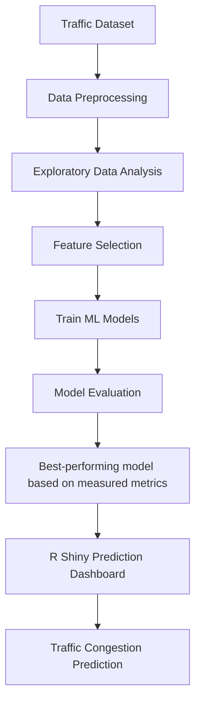
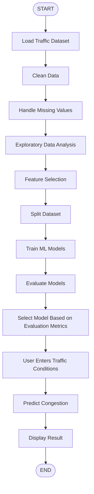

# Traffic Congestion Prediction and Analysis Using R and Machine Learning

**A Mini Project Report**

Submitted by: *(Student name, Roll number)*
Department: *(Department name)* | College: *(College name)* | Academic year: *(Year)*
Guide: *(Guide name)*

> **How to finish this report:** Sections 20 and 21 (Results, Model Comparison) must contain the
> *measured* numbers from your own run. Run `source("run_pipeline.R")` in RStudio, open
> `outputs/results_summary.md` and paste the tables there. The text of this report never
> contains invented performance values.

---

## 1. Title

**Traffic Congestion Prediction and Analysis Using R and Machine Learning**

---

## 2. Abstract

Traffic congestion in cities causes travel delays, fuel wastage and pollution. This project builds a
traffic analytics and prediction system using **R**, **machine learning** and **R Shiny**. A synthetic
dataset of about 1,500 traffic records (date, time, day, hour, vehicle count, average speed, rainfall,
temperature, accident, road type, holiday, number of traffic signals, road width and congestion level)
is generated in R with a fixed random seed. The data is cleaned (missing values, duplicates, invalid
values, data types, encoding), explored with ten `ggplot2` graphs, and summarised with statistics
such as mean, median, standard deviation and correlation. Three classification models - **Logistic
Regression, Decision Tree and Random Forest** - are trained on 80% of the data to predict congestion as
**Low, Medium or High**, and evaluated on the remaining 20% using accuracy, precision, recall, F1-score
and confusion matrices. The best model, selected from the measured metrics, is used in an R Shiny
dashboard called *Traffic Monitor* where a user enters traffic conditions and obtains the predicted
congestion level with a simple explanation.

---

## 3. Introduction

Road traffic is growing faster than road capacity in most cities. During office hours, bad weather or
after an accident, roads become congested. If authorities and commuters could know the expected
congestion level in advance, they could choose better routes, change signal timings or send
traffic police to the right place.

Data analytics and machine learning help to discover patterns in historical traffic data and use
them for prediction. R is a language designed for statistics and data analysis and has strong packages
for data handling (`tidyverse`), graphs (`ggplot2`), machine learning (`caret`, `randomForest`) and
web applications (`shiny`). This project combines all of them into one complete, easy-to-understand system.

---

## 4. Background

- **Traffic congestion** happens when the number of vehicles is close to (or more than) what the road can carry, so speed falls.
- **Factors** that influence congestion: time of day (rush hours), day of week, holidays, rainfall, accidents, road type, road width and number of traffic signals.
- **Machine learning classification** predicts a category (here Low / Medium / High) from input features.
- **R Shiny** converts R code into an interactive web application without needing HTML/JavaScript knowledge.

---

## 5. Existing System

Traditional traffic management relies on:

1. Manual observation by traffic police.
2. Fixed-time traffic signals that do not adapt to conditions.
3. Basic counting sensors that give only current counts, without prediction.
4. Navigation apps that are powerful but closed-source, and not designed for learning or analysis by students.

**Drawbacks:** no prediction of future congestion, no easy analysis of the causes, and high dependence on human judgement.

---

## 6. Problem Statement

Urban areas experience traffic congestion during peak hours, weekends, bad weather, accidents and other
unusual situations. Congestion causes travel delays, fuel consumption and increased pollution. A system is
needed that analyses historical traffic data, identifies the factors that contribute to congestion, and
predicts the expected congestion level (Low, Medium or High) for new traffic conditions.

---

## 7. Objectives

1. Create a realistic, reproducible traffic dataset with at least 1,000 records.
2. Clean and prepare the data for machine learning.
3. Explore the data with statistics and graphs to understand causes of congestion.
4. Build three classification models and compare them with accuracy, precision, recall and F1-score.
5. Choose the best model from the measured metrics.
6. Build an R Shiny dashboard with analysis, visualisation, model performance and a prediction form.
7. Handle invalid input and failures with friendly messages.

---

## 8. Proposed System

The proposed system is a complete pipeline: **dataset -> preprocessing -> exploratory analysis -> feature
selection -> model training -> evaluation -> best model -> Shiny dashboard -> prediction**.
The same cleaning rules and the same categories (factor levels) are used for the training data and for
new data typed by the user, so predictions are consistent with training.

---

## 9. Scope

- **In scope:** single-location hourly traffic records, three algorithms, offline historical data, web dashboard for one user.
- **Out of scope:** live sensor feeds, GPS data, route planning, multi-city comparison, deep learning.

---

## 10. System Requirements

| Type | Requirement |
|---|---|
| Hardware | Any laptop with 4 GB RAM (8 GB recommended), 1 GB free disk space |
| Operating system | Windows 10/11, macOS or Linux |
| Software | R 4.1 or newer, RStudio Desktop, web browser |
| R packages | shiny, shinydashboard, DT, plotly, tidyverse, caret, randomForest, rpart, nnet, e1071, scales |

---

## 11. Dataset Description

**Source: synthetic.** No real dataset was used. The data was generated in R (`generate_traffic_data()`
in `R/data_preprocessing.R`) with `set.seed(123)`, so every run produces the same file.

The generator follows real-world rules: morning and evening rush hours, fewer vehicles on weekends and
holidays, rain reduces speed and vehicle count, accidents reduce speed, wider roads carry more vehicles,
and speed falls when the road becomes crowded. Congestion level is computed from a score made of vehicle
load, speed loss, accident, rainfall and signals plus random noise, and then split by percentiles
(lowest 40% = Low, next 35% = Medium, highest 25% = High).

A few missing values, impossible values and duplicate rows are added on purpose so the preprocessing step is meaningful.

| Column | Type | Description |
|---|---|---|
| Date | Date | Date of observation (Jan-Jun 2026) |
| Time | Text | Time of observation (HH:MM) |
| Day_of_Week | Category | Monday ... Sunday |
| Hour | Integer | Hour of day, 0-23 |
| Vehicle_Count | Integer | Vehicles per hour |
| Average_Speed | Number | Average speed in km/h |
| Rainfall_mm | Number | Rainfall in millimetres |
| Temperature_C | Number | Temperature in degrees Celsius |
| Accident | Yes/No | Accident reported |
| Road_Type | Category | Highway, City Road, Arterial Road, Residential Street |
| Holiday | Yes/No | Holiday or not |
| Traffic_Signal_Count | Integer | Signals on the road section |
| Road_Width | Number | Road width in metres |
| Congestion_Level | Category (target) | Low, Medium, High |

**Real data alternative:** a real dataset (for example a public hourly traffic-volume dataset) can be used
by converting it to the same 14 columns. Its source must then be cited in this section.

---

## 12. Data Preprocessing

Implemented in `preprocess_traffic_data()`:

1. **Load the CSV** with `readr::read_csv()`.
2. **Display structure** with `glimpse()` (before and after).
3. **Tidy text** (trim spaces, consistent capitalisation such as "yes" -> "Yes").
4. **Convert data types**: Date -> `Date`, numbers -> numeric, categories -> factors with fixed levels.
5. **Remove duplicates** with `distinct()`.
6. **Detect obvious outliers / invalid values** using physically possible ranges (for example speed must be 1-130 km/h, vehicle count 0-5000). Impossible values are set to missing.
7. **Handle missing values**: numeric columns are filled with the **median**, categorical columns with the **most common value**.
8. **Outlier report** with the IQR rule (values beyond 1.5 x IQR are listed; real extreme-but-possible values are kept).
9. **Encode categorical variables**: factors (and a numeric-code view via `encode_categoricals()`). Model functions create dummy variables internally.
10. **Before-and-after table** of rows, columns, missing values and duplicates.

Measured before/after values are in `outputs/results_summary.md` and on the dashboard's *Dataset* tab.

---

## 13. Exploratory Data Analysis

Ten `ggplot2` graphs are produced (files in `outputs/plots/`):

1. Vehicle count by hour 2. Traffic by day of week 3. Average speed by congestion level
4. Vehicle count vs average speed 5. Rainfall vs congestion 6. Accident vs congestion
7. Holiday vs congestion 8. Congestion distribution 9. Road type vs congestion 10. Hourly congestion trend

**Statistical analysis** (`compute_statistics()`): mean, median, standard deviation, minimum and maximum of vehicle
count, average speed, the correlation between vehicle count and speed, and the correlation between rainfall and
vehicle count. The function `interpret_statistics()` turns the computed values into simple sentences (for example
whether the correlation is weak or strong, positive or negative). Insert your measured values in Section 20.

---

## 14. Feature Selection

| Feature | Used? | Reason |
|---|---|---|
| Date, Time | No | Identifiers; Hour and Day_of_Week already hold the useful information, and a raw date lets a model memorise instead of learn |
| Day_of_Week, Hour | Yes | Rush-hour and weekday patterns |
| Vehicle_Count, Average_Speed | Yes | Direct measures of traffic load |
| Rainfall_mm, Temperature_C | Yes | Weather effect |
| Accident, Holiday | Yes | Unusual situations |
| Road_Type, Road_Width, Traffic_Signal_Count | Yes | Road capacity |

Feature importance from the Random Forest (`Mean Decrease in Gini`) is shown on the *Model Performance* tab so you
can see which inputs matter most in your run.

---

## 15. Machine Learning Algorithms

**Logistic Regression** - A statistical model that calculates the probability of each class from a weighted sum of
the inputs. Because there are three classes, *multinomial* logistic regression (`nnet::multinom`) is used. Inputs are
centred and scaled. Easy to interpret, assumes mostly linear relationships.

**Decision Tree** - A flowchart of yes/no questions (for example "Is speed < 30?"). Built with `rpart`. Very easy to
explain, but a single tree can be unstable.

**Random Forest** - Many decision trees (200 here) built on random samples; their votes are combined. Usually more accurate and
less over-fitted than one tree. Built with `randomForest`.

All models are trained with `caret::train()`; the data is split 80% training / 20% testing using a stratified split
with `set.seed(123)`.

**Evaluation metrics** (macro-averaged over Low, Medium, High):
- Accuracy = correct predictions / all predictions
- Precision = of the records predicted as a class, how many really belong to it
- Recall = of the records that really belong to a class, how many were found
- F1-score = harmonic mean of precision and recall
- Confusion matrix = table of actual vs predicted classes

---

## 16. System Architecture

```text
            +---------------------+
            |   Traffic Dataset   |   (synthetic CSV, 14 columns)
            +----------+----------+
                       v
            +---------------------+
            | Data Preprocessing  |   (clean, convert, impute, encode)
            +----------+----------+
                       v
            +---------------------+
            | Exploratory Analysis|   (statistics + 10 ggplot2 graphs)
            +----------+----------+
                       v
            +---------------------+
            |  Feature Selection  |
            +----------+----------+
                       v
            +---------------------+
            |   Train ML Models   |   (Logistic Regression, Decision Tree, Random Forest)
            +----------+----------+
                       v
            +---------------------+
            |  Model Evaluation   |   (accuracy, precision, recall, F1, confusion matrix)
            +----------+----------+
                       v
            +---------------------+
            | Best-performing     |   (chosen from measured metrics)
            | model               |
            +----------+----------+
                       v
            +---------------------+
            | R Shiny Dashboard   |
            +----------+----------+
                       v
            +---------------------+
            | Congestion          |   (Low / Medium / High)
            | Prediction          |
            +---------------------+
```

Mermaid version (renders in GitHub / VS Code / many Markdown viewers):



---

## 17. Methodology

1. Generate / load the dataset.
2. Clean and prepare the data.
3. Analyse the data with statistics and graphs.
4. Select the input features.
5. Split data 80:20 (stratified, seed 123).
6. Train Logistic Regression, Decision Tree and Random Forest.
7. Predict on the test set and compute the metrics.
8. Select the model with the highest F1-score (accuracy breaks ties).
9. Save models in `models/trained_model.rds`.
10. Load the saved models in the Shiny app; validate user input; build a one-row data frame with the same factor levels as the training data; predict; explain.

---

## 18. Flowchart

```text
                START
                  |
                  v
        Load Traffic Dataset
                  |
                  v
             Clean Data
                  |
                  v
       Handle Missing Values
                  |
                  v
   Exploratory Data Analysis
                  |
                  v
         Feature Selection
                  |
                  v
           Split Dataset
                  |
                  v
         Train ML Models
                  |
                  v
          Evaluate Models
                  |
                  v
 Select Model Based on Evaluation Metrics
                  |
                  v
 User Enters Traffic Conditions
                  |
                  v
        Predict Congestion
                  |
                  v
          Display Result
                  |
                  v
                 END
```



---

## 19. Implementation

| File | Purpose |
|---|---|
| `R/data_preprocessing.R` | Dataset generator, CSV loading, cleaning, input validation, new-observation builder |
| `R/analysis.R` | Statistics, correlations, plain-language interpretation |
| `R/visualization.R` | Ten EDA graphs, confusion-matrix plot, comparison plot, feature-importance plot |
| `R/model_training.R` | Split, train three models, evaluate, pick best, save/load, predict, explain |
| `app.R` | Shiny dashboard with seven tabs |
| `run_pipeline.R` | Runs the complete project in the console and writes `outputs/results_summary.md` |

**Error handling in the app:** missing dataset (regenerated automatically), damaged or missing model file
(retrained), empty or non-numeric input, out-of-range values, unknown category values, and any prediction error are
caught with `tryCatch()` and shown as readable messages; the app does not crash.

---

## 20. Results

> Paste here the content of `outputs/results_summary.md` produced by **your** run:
> preprocessing before/after table, statistics table, correlation values and their meaning.

| Item | Your measured value |
|---|---|
| Records after cleaning | *(from results_summary.md)* |
| Mean / median vehicle count | *(from results_summary.md)* |
| Standard deviation | *(from results_summary.md)* |
| Minimum / maximum vehicle count | *(from results_summary.md)* |
| Average speed | *(from results_summary.md)* |
| Correlation: vehicle count vs speed | *(from results_summary.md)* |
| Correlation: rainfall vs vehicle count | *(from results_summary.md)* |

Also insert the graphs from `outputs/plots/` (files `01_...png` to `10_...png`) and write 1-2 lines under each,
for example what the hourly graph shows about rush hours. The sentences produced by `interpret_statistics()` can be reused.

---

## 21. Model Comparison

> Paste the table from `outputs/results_summary.md` (also shown on the dashboard's *Model Performance* tab).

| Model | Accuracy | Precision | Recall | F1 Score |
|---|---:|---:|---:|---:|
| Logistic Regression | *(measured)* | *(measured)* | *(measured)* | *(measured)* |
| Decision Tree | *(measured)* | *(measured)* | *(measured)* | *(measured)* |
| Random Forest | *(measured)* | *(measured)* | *(measured)* | *(measured)* |

**Best model (highest F1-score):** *(name shown by the program)*

Insert the three confusion-matrix images (`outputs/plots/cm_*.png`) and comment on which classes are confused
most often (usually neighbouring levels such as Medium vs High).

**Important note on interpretation:** because the data is synthetic and the labels follow a rule plus noise, these
scores demonstrate the method; they do not predict performance in a real city.

---

## 22. Shiny Dashboard

The dashboard *Traffic Monitor* has a light theme, a sidebar menu and seven tabs:

1. **Home** - title, problem statement, objective, how the system works, summary cards.
2. **Dataset** - data table, number of records and variables, summary statistics, before/after cleaning, outliers, structure.
3. **Traffic Analysis** - statistic cards with plain-language explanation, hourly, daily, speed and road-type graphs.
4. **Visualization** - interactive `plotly` graphs: traffic by hour/day, vehicles vs speed, weather, accident, holiday.
5. **Model Performance** - comparison table, chart, three confusion matrices, per-class metrics, feature importance.
6. **Traffic Prediction** - input form for 11 inputs, **Predict Traffic** button, result such as
   *Predicted Congestion Level: HIGH*, probability bars, input summary and explanation.
7. **About** - project information, technologies, dataset information, limitations, future improvements.

*(Insert screenshots of each tab here.)*

---

## 23. Advantages

- Complete end-to-end workflow in one language (R).
- Reproducible: fixed seeds and a data generator.
- Three models compared fairly on identical train/test data.
- Same preprocessing for training and prediction.
- Friendly dashboard with input validation and explanations.
- Simple enough to explain in a viva; no complicated technology.

---

## 24. Limitations

- Synthetic data; real traffic is more irregular.
- Congestion labels come from a rule with noise, so they are easier to learn than real labels.
- One simple train/test split; no cross-validation or hyper-parameter tuning.
- Single location and hourly resolution; no live data, events or road works.
- Models predict the level for given conditions; they do not forecast the future time series.

---

## 25. Future Enhancement

- Use real sensor / GPS traffic data from a traffic authority.
- Add cross-validation and hyper-parameter tuning; try gradient boosting.
- Connect live weather and traffic APIs.
- Show predicted congestion on a map; forecast the next few hours.
- Deploy the app on shinyapps.io or a college server.

---

## 26. Conclusion

The project shows how R and machine learning can be used to analyse traffic data, find the factors linked with
congestion and predict the congestion level. Three classification models were built and compared with accuracy,
precision, recall, F1-score and confusion matrices, and the best-performing model (according to the measured metrics)
powers an interactive Shiny dashboard. The system is reproducible, handles errors gracefully and can be extended to
real data in future.

---

## 27. References

1. R Core Team. *R: A Language and Environment for Statistical Computing.* R Foundation for Statistical Computing, Vienna. https://www.r-project.org
2. Wickham, H. et al. (2019). Welcome to the tidyverse. *Journal of Open Source Software*, 4(43), 1686.
3. Wickham, H. (2016). *ggplot2: Elegant Graphics for Data Analysis.* Springer.
4. Kuhn, M. (2008). Building predictive models in R using the caret package. *Journal of Statistical Software*, 28(5).
5. Breiman, L. (2001). Random forests. *Machine Learning*, 45(1), 5-32.
6. Breiman, L., Friedman, J., Olshen, R., Stone, C. (1984). *Classification and Regression Trees.* Wadsworth.
7. James, G., Witten, D., Hastie, T., Tibshirani, R. *An Introduction to Statistical Learning.* Springer.
8. Chang, W. et al. *shiny: Web Application Framework for R.* https://shiny.posit.co
9. Liaw, A., Wiener, M. (2002). Classification and regression by randomForest. *R News*, 2(3), 18-22.
